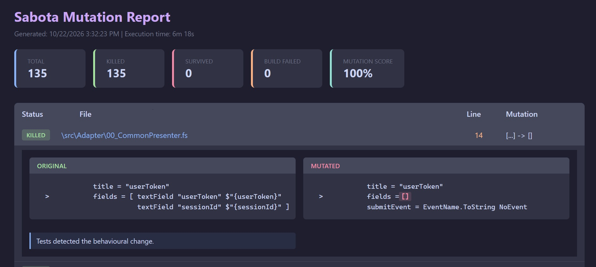

# Sabota
Mutation testing for F#.
It is currently in its prototyping phase but already working and usable on real code.
Suggestions welcome.

### Features
- AST-based discovery
- Source-text mutation
- Workspace isolation
- HTML reporting
- Configurable mutation categories

## Installation

### From NuGet
```powershell
dotnet tool install --global Sabota
```

### From Source
```powershell
dotnet publish src/Sabota/Sabota.fsproj -c Release
```

## Usage

### Initialize a config file
```powershell
sabota init
```
Creates a `sabota.json` in the current directory with all mutation categories enabled. Edit the file to set your `testProject` and `solutionRoot` paths.

### Run mutation testing
```powershell
sabota
```
Reads settings from `sabota.json` in the current directory. Override any setting via CLI:

| Flag | Description |
|---|---|
| `-t <project>` | Path to the unit test project (`.fsproj`) |
| `-s <root>` | Path to the solution root directory |
| `-f <files>` | Comma-separated F# source files to mutate |
| `-d <dirs>` | Comma-separated directories to scan |
| `-c <cats>` | Comma-separated mutation categories to enable |
| `-config <path>` | Path to a custom config file |

CLI arguments always take precedence over config file settings.

### Help & Version
```powershell
sabota --help
sabota --version
```

### Examples
```powershell
# Mutate specific files
sabota -f src/Module1.fs,src/Module2.fs

# Mutate a subdirectory
sabota -d src/Core

# Filter to specific categories
sabota -c Boolean,Arithmetic

# Use a custom config file from any directory
sabota -config D:\projects\MyApp\sabota.json
```

### Example Report
HTML report allows browsing and filtering results.


## Known Limitations
- Still in the prototyping phase
- F# projects only
- Not all mutation categories are implemented yet
- Equivalent mutants are not yet detected

## Antivirus
The self-contained single-file executable may occasionally trigger antivirus warnings because it is unsigned.
Build from source instead:
```powershell
dotnet publish src/Sabota/Sabota.fsproj -c Release
```
The full source code used to produce these binaries is available in this repository.

### Roadmap
- Custom business-domain mutations
- DU discovery and mutation suggestions
- Improved reporting and filtering
- Additional mutation categories
- Performance optimizations where needed

## About
Sabota — friendly neighborhood code vandalism for F#.

Mutation testing works by introducing small changes into your code and verifying that your tests detect the behavioural change. A high code coverage percentage does not necessarily mean your tests are effective. Sabota helps identify assertions that are missing, weak, or too implementation-focused.

Run it against a project you think is well tested. The first surviving mutant is often more interesting than dozens of passing tests.

Suggestions, bug reports, and feedback are welcome.