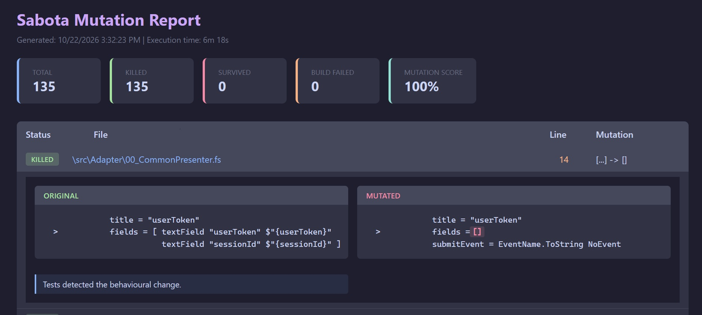

# Sabota
Mutation testing for F#. 
It is currently in its prototyping phase but already working and usable on real code.
Suggestions welcome.

### Features
- AST-based discovery
- Source-text mutation
- Workspace isolation
- HTML reporting
- Configurable mutation categories


### Quick Start
Download the executable and run in terminal

1. specify test project and solution root folder
```Powershell
.\Sabota.exe -t path\UnitTest.fsproj -s solutionRootFolderPath
sabota
```

2. specify test project ,solution root folder and filter to mutate only subfolder files
```Powershell
.\Sabota.exe -t path\UnitTest.fsproj -s solutionRootFolderPath -d subFolderPath
sabota
```

3. specify test project ,solution root folder and filter to mutate only specific files
```Powershell
.\Sabota.exe -t path\UnitTest.fsproj -s solutionRootFolderPath -f file1Path,file2Path
sabota
```

4. filter the mutation category 
```Powershell
.\Sabota.exe -t path\UnitTest.fsproj -s solutionRootFolderPath -c boolean,Arithmetic,Conditional 
sabota
```

 >Any command line argument overwrites the default you can and specify in sabota_config.json


### Example Report
Html report allows to browse and filter results


## Known Limitations
- Still in the prototyping phase
- F# projects only
- Not all mutation categories are implemented yet
- Equivalent mutants are not yet detected

## Antivirus
The self-contained single-file executable may occasionally trigger antivirus warnings because it is an unsigned executable.
If you prefer, you can build Sabota directly from source:
dotnet publish src/Sabota/Sabota.fsproj -c Release
The full source code used to produce these binaries is available in this repository.

### Roadmap
- Custom business-domain mutations
- DU discovery and mutation suggestions
- Improved reporting and filtering
- Additional mutation categories
- Performance optimizations where needed


### Try it on your project [^1]
Sabota. Friendly neighborhood code vandalism for F#.

Mutation testing works by introducing small changes into your code and verifying that your tests detect the behavioural change.

A high code coverage percentage does not necessarily mean your tests are effective. Sabota helps identify assertions that are missing, weak, or too implementation-focused.

Run it against a project you think is well tested. The first surviving mutant is often more interesting than dozens of passing tests.

Suggestions, bug reports, and feedback are welcome. Sabota is still very much in the prototyping phase.


[^1]: Because your test suite is lying to you, and we're here to prove it.

